<!-- LOGO -->
<h1>

  
   Mario Terminal
</h1>
  

    Mario is a modern terminal built to run everywhere.
     
    <a href="#about">About</a>
    ·
    <a href="https://marioterm.com/docs/install">Install</a>
    ·
    <a href="https://marioterm.com/docs/config">Config</a>
    ·
    <a href="https://marioterm.com/changelog">Changelog</a>
    ·
    <a href="https://github.com/sponsors/raphamorim">Sponsor</a>
  

Documentation: [marioterm.com](https://marioterm.com).

## About

Mario is a hardware-accelerated GPU terminal emulator, a fork and rebrand of [Rio](https://github.com/raphamorim/rio) focused on cross-platform reliability (Linux, macOS, Windows, and WebAssembly) with modern typography and refined defaults.

### Why Mario?

Mario was created to provide an independently maintained, finely tuned terminal experience tailored for modern development workflows:

- **Refined Typography Out of the Box**: Shipped with JetBrains Mono Nerd Font ([JBD2](https://github.com/partrita/JBD2)) by default, offering clean ligatures and comprehensive developer icons without needing manual font installations.
- **Enhanced Multi-Platform Font Rendering**: Calibrated font rasterization across all operating systems — utilizing subpixel quantization on macOS CoreText, alongside stem-darkening compensation and hinting on Windows and Linux (Swash) — ensuring text remains razor-sharp on both high-DPI and standard displays.
- **Thoughtful Default Aesthetic**: Integrated with the Rosé Pine palette out of the box, defaulting to `rose-pine-dawn` (light) with seamless adaptive switching to `rose-pine-moon` (dark) following system appearance.
- **Independent Release Pipeline**: Dedicated CI/CD, modernized packaging workflows, and a distinct visual identity (Mario's signature white mustache logo).

### Key Changes from Rio

- **Default Font & Icons**: Embedded `JBD2NF-Regular` ([JBD2](https://github.com/partrita/JBD2) - JetBrains Mono Nerd Font) replacing `SymbolsNerdFontMono`, and set `jbd2nf` as the primary font family.
- **Font Rasterization Enhancements**: Enabled CoreGraphics subpixel quantization on macOS and size-proportional stem-darkening on Windows and Linux to prevent thin/washed-out glyphs on light backgrounds.
- **Built-in Rosé Pine Themes**: Native zero-configuration support for `rose-pine-dawn` (default) and `rose-pine-moon`, with automatic light/dark adaptive switching.
- **Performance & Resource Optimizations**:
  - **Embedded Font Compression**: Compressed raw font assets at build time via `miniz_oxide` deflate, decompressed lazily into memory on boot (`LazyLock`), cutting binary `.rodata` font footprint by over 5 MB (>50% size reduction).
  - **Trimmed Dependencies & Isolated WGPU**: Decoupled `wgpu` into an optional/target-specific dependency (active on Windows & WASM, bypassed on Linux Vulkan and macOS Metal), and pruned unused `image_rs` decoders (`tiff`, `pnm`, `bmp`, `gif`).
  - **GPU VRAM & Atlas Footprint Reduction**: Rescaled initial WebGPU glyph atlas from 2048 to 1024 (saving 75% initial texture VRAM per window) matching Metal/CPU backends, while maintaining dedicated 8-bit `R8Unorm` grayscale text masking.
  - **Size-Optimized Release Profile**: Configured `opt-level = "s"`, fat LTO (`lto = "fat"`), `codegen-units = 1`, `panic = "abort"`, and `strip = "symbols"` for minimal executable size and maximum dead-code elimination.
- **Project Rebranding**: Workspace-wide crate renaming (`rio-*` to `mario-*`), updated repository endpoints (`partrita/mario`), and regenerated high-resolution icon assets (`.ico` and `.svg`).

## What's New in 0.5.30

- **Row-level glyph uploads**: The Metal and Vulkan grid backends now keep a fixed vertex-buffer slot per row and upload only rows written since the last frame. Typing and scrolling no longer re-copy the whole grid to the GPU on every change.
- **Smarter damage tracking**: Search mode only rescans and requests `Full` damage when the query, viewport, or terminal content actually changes; game mode still renders every frame but no longer rebuilds every row. The visible-row snapshot also reuses row allocations instead of deep-cloning them.
- **Cheaper text shaping**: The shaped-run cache now hands out an `Rc` instead of cloning the glyph vector on every cache hit, removing per-frame heap allocations for tab titles, overlays, and tooltips.
- **First-run configuration**: The first launch writes a fully commented `config.toml` plus editable `themes/rose-pine-dawn.toml` and `themes/rose-pine-moon.toml` under the config directory. Existing files are never overwritten.

## Supporting the Project

If you use and like Mario, please consider sponsoring it: your support helps to cover the fees required to maintain the project and to validate the time spent working on it!

## Packaging

> Demo with split and CRT on MacOS

> Demo with blurred background on Linux

> Demo of Mario running on a Steam Deck

## Minimal stable rust version

Mario's MSRV is 1.96.1.

